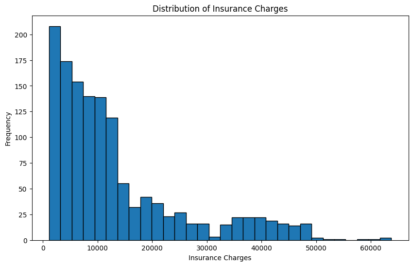
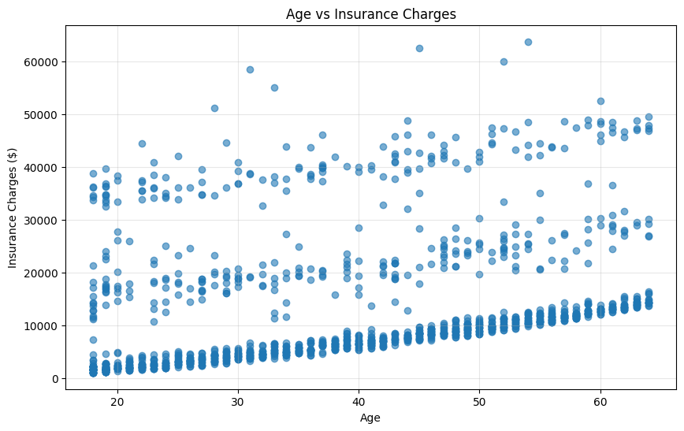
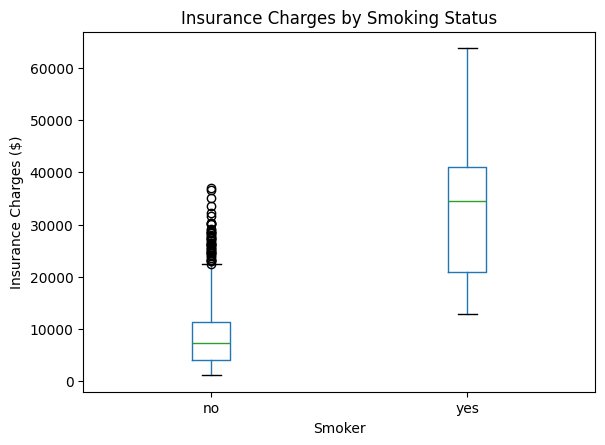
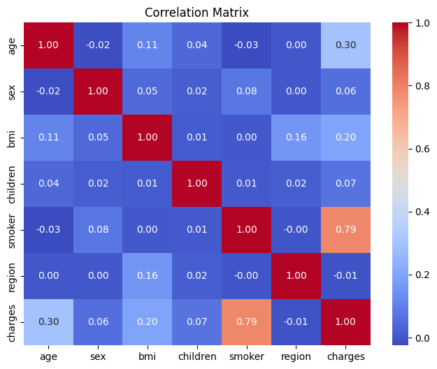

# 📊 Insurance Risk Analysis using Monte Carlo Simulation, Statistical Modeling & Multiple Linear Regression


---

# 📖 Project Overview

This project performs a comprehensive **Insurance Risk Analysis** using a real-world medical insurance dataset. The analysis combines **Exploratory Data Analysis (EDA)**, **Statistical Hypothesis Testing**, **Multiple Linear Regression**, and **Monte Carlo Simulation** to estimate future insurance losses and evaluate financial risk.

The project demonstrates practical applications of:

- Exploratory Data Analysis (EDA)
- Descriptive Statistics
- Correlation Analysis
- Statistical Hypothesis Testing
- Multiple Linear Regression
- Monte Carlo Simulation
- Value at Risk (VaR)
- Conditional Value at Risk (CVaR)

---

# 📂 Dataset

**Source:** Medical Cost Personal Dataset (Kaggle)

### Dataset Summary

| Attribute | Description |
|-----------|-------------|
| Records | 1,338 |
| Features | 6 |
| Target Variable | Insurance Charges |

### Variables

- Age
- Sex
- BMI
- Children
- Smoker
- Region
- Charges (Target)

---

# 💻 Technologies Used

- Python
- NumPy
- Pandas
- Matplotlib
- SciPy
- Scikit-learn
- Google Colab

---

# 📊 Project Visualizations

## Distribution of Insurance Charges



---

## Age vs Insurance Charges



---

## Insurance Charges by Smoking Status



---

## Correlation Heatmap



---

## Monte Carlo Simulation


---

# 📈 Exploratory Data Analysis

The dataset was analyzed to understand the distribution of insurance costs and identify important predictors.

Performed:

- Missing Value Analysis
- Descriptive Statistics
- Distribution Analysis
- Correlation Matrix
- Scatter Plots
- Box Plots

### Major Findings

- No missing values
- Insurance charges are positively skewed
- Smoking status has the strongest correlation with insurance charges
- Age and BMI also influence insurance costs

---

# 📊 Statistical Analysis

## Correlation with Insurance Charges

| Variable | Correlation |
|-----------|------------:|
| Smoker | **0.79** |
| Age | 0.30 |
| BMI | 0.20 |
| Children | 0.07 |
| Sex | 0.06 |
| Region | -0.01 |

---

## Hypothesis Testing

Welch's Independent Samples t-test

### Results

| Statistic | Value |
|-----------|--------|
| T Statistic | 32.752 |
| P Value | 5.89 × 10⁻¹⁰³ |

### Conclusion

The p-value is significantly less than 0.05.

Therefore, the null hypothesis is rejected, indicating that smokers incur significantly higher insurance charges than non-smokers.

---

# 🤖 Multiple Linear Regression

The regression model was trained to predict insurance charges.

## Model Performance

| Metric | Value |
|--------|-------|
| R² Score | **0.784** |
| MAE | **$4,181** |
| RMSE | **$5,796** |

## Most Important Features

| Feature | Coefficient |
|----------|------------:|
| Smoker | +23,651 |
| Children | +425 |
| BMI | +337 |
| Age | +257 |

### Interpretation

Smoking status is the strongest predictor of insurance costs.

---

# 🎲 Monte Carlo Simulation

A bootstrap-based Monte Carlo Simulation was performed using:

- 10,000 Simulations
- Random Sampling with Replacement

## Risk Metrics

| Metric | Value |
|--------|-------|
| Mean Annual Loss | $17.74 Million |
| Median Annual Loss | $17.74 Million |
| Standard Deviation | $445,874 |
| 95% Value at Risk (VaR) | $18.49 Million |
| 95% Conditional Value at Risk (CVaR) | $18.67 Million |

---

# 📌 Business Insights

- Smokers cost approximately **3.8×** more than non-smokers.
- Smoking is the strongest driver of insurance expenses.
- The regression model explains **78.4%** of the variability in insurance charges.
- Monte Carlo Simulation provides realistic estimates of annual insurance risk.
- Risk metrics such as VaR and CVaR help estimate worst-case financial losses.

---

# 📊 Key Results

| Metric | Value |
|--------|-------|
| Dataset Size | 1,338 |
| Monte Carlo Simulations | 10,000 |
| Mean Annual Loss | $17.74 Million |
| VaR (95%) | $18.49 Million |
| CVaR (95%) | $18.67 Million |
| Regression R² | 0.784 |
| MAE | $4,181 |
| RMSE | $5,796 |

---

# 💼 Skills Demonstrated

- Python Programming
- Data Cleaning
- Data Visualization
- Statistical Analysis
- Hypothesis Testing
- Monte Carlo Simulation
- Risk Analysis
- Machine Learning
- Linear Regression
- Business Analytics
- Financial Risk Modeling

---

# 📁 Project Structure

```
insurance-risk-analysis-monte-carlo/
│
├── data/
│   └── insurance.csv
│
├── images/
│   ├── age_vs_charges.png
│   ├── charges_distribution.png
│   ├── correlation_heatmap.png
│   ├── monte_carlo_simulation.png
│   └── smoker_boxplot.png
│
├── notebooks/
│   └── Monte_Carlo_Insurance_Risk_Simulation.ipynb
│
├── report/
│   └── Insurance_Risk_Report.pdf
│
├── src/
│   └── monte_carlo_simulation.py
│
├── README.md
├── requirements.txt
├── LICENSE
└── .gitignore
```

---

# 🚀 Installation

```bash
git clone https://github.com/itsjustdinesh/insurance-risk-analysis-monte-carlo.git

cd insurance-risk-analysis-monte-carlo

pip install -r requirements.txt

jupyter notebook
```

---

# 🔮 Future Improvements

- Random Forest Regression
- XGBoost Regression
- Streamlit Dashboard
- Interactive Risk Calculator
- Time-Series Risk Forecasting
- Cloud Deployment

---

# 👨‍💻 Author

**Dinesh Kumar**

🎓 Master's Student – Data Science

🏫 TU Dortmund University

📍 Germany

---

# ⭐ If you found this project useful

Please consider giving the repository a ⭐ on GitHub.
