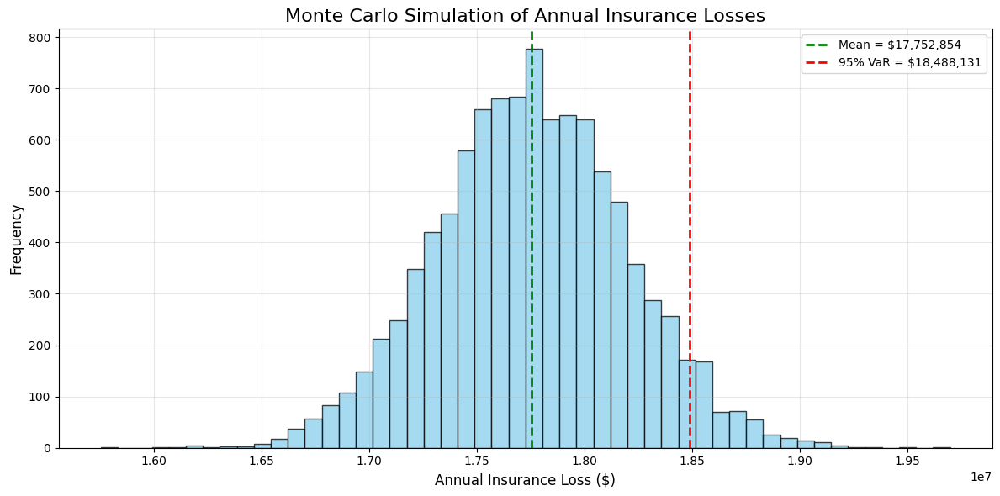

# 📊 Insurance Risk Analysis using Monte Carlo Simulation

> Statistical Analysis • Monte Carlo Simulation • Multiple Linear Regression • Risk Analytics


---

## 📖 Project Overview



This project analyzes a real-world medical insurance dataset using statistical analysis, multiple linear regression, and Monte Carlo simulation.

The objective is to estimate future annual insurance losses and evaluate financial risk using Value at Risk (VaR) and Conditional Value at Risk (CVaR).

---

## 📂 Dataset

- Source: Kaggle Medical Cost Personal Dataset
- Records: **1,338**
- Features:
  - Age
  - Sex
  - BMI
  - Children
  - Smoker
  - Region
- Target Variable:
  - Insurance Charges

---

## 🛠 Technologies Used

- Python
- NumPy
- Pandas
- Matplotlib
- SciPy
- Scikit-learn

---

## 📈 Exploratory Data Analysis

Performed:

- Descriptive Statistics
- Missing Value Analysis
- Distribution Analysis
- Correlation Analysis
- Box Plots
- Scatter Plots

Major finding:

**Smoking status is the strongest predictor of insurance charges.**

---

## 📊 Statistical Analysis

### Correlation with Insurance Charges

| Variable | Correlation |
|-----------|------------:|
| Smoker | **0.79** |
| Age | 0.30 |
| BMI | 0.20 |
| Children | 0.07 |
| Sex | 0.06 |
| Region | -0.01 |

---

### Hypothesis Testing

Welch's Independent Samples t-test

**Result**

- t = 32.752
- p < 0.001

Conclusion:

Insurance charges for smokers are significantly higher than for non-smokers.

---

## 🤖 Multiple Linear Regression

Model Performance

| Metric | Value |
|---------|------:|
| R² | **0.784** |
| MAE | **$4,181** |
| RMSE | **$5,796** |

Most Important Predictor:

- Smoking Status (+$23,651)

---

## 🎲 Monte Carlo Simulation

Simulation Method:

- Bootstrap Sampling
- 10,000 Simulations

Risk Metrics:

| Metric | Value |
|--------|-------:|
| Mean Annual Loss | $17.74 Million |
| Standard Deviation | $445,874 |
| VaR (95%) | $18.49 Million |
| CVaR (95%) | $18.67 Million |

---

## 📌 Business Insights

- Smokers cost approximately **3.8×** more than non-smokers.
- Smoking status is the strongest predictor of insurance expenses.
- The regression model explains **78.4%** of the variation in insurance charges.
- Monte Carlo simulation provides realistic estimates of annual financial risk.

---

## 📁 Project Structure

```
Insurance-Risk-Monte-Carlo/
│
├── data/
├── notebooks/
├── images/
├── report/
├── README.md
├── requirements.txt
└── LICENSE
```

---

## 🚀 Future Improvements

- Random Forest Regression
- XGBoost Regression
- Interactive Dashboard
- Streamlit Web App
- Scenario-Based Risk Analysis

---

## 👨‍💻 Author

**Dinesh Kumar**

Master's Student – Data Science

TU Dortmund University

Germany
